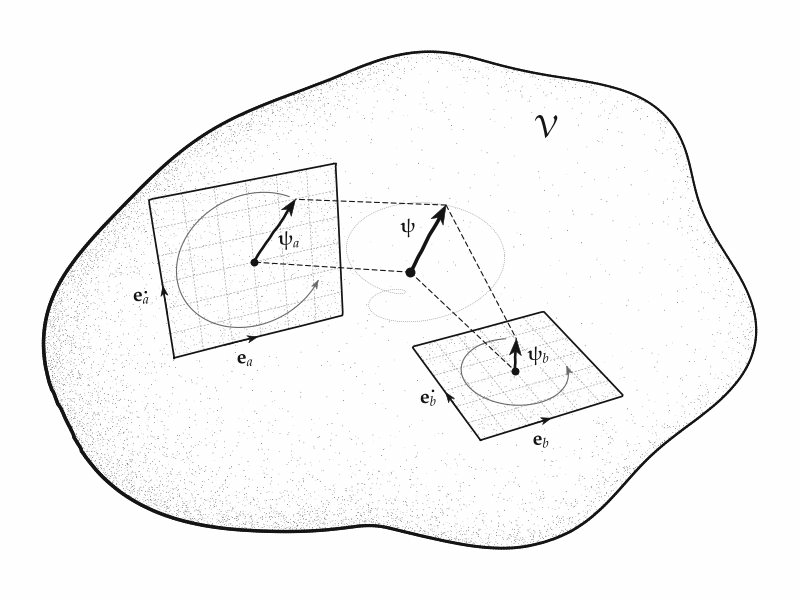

# Conjugate Planes

A quantum state of $n$ modes is a vector of $\mathbb{C}^n$, and morphis reads it as a real vector of $\mathcal{V} = \mathbb{R}^{2n}$. Each mode $m$ owns a direction $\mathbf{e}_m$ and its partner $\mathbf{e}_{\dot m}$, and the two span the mode's *conjugate plane*, the blade $\mathbf{e}_{m \dot m}$. This example takes a qubit, two modes $a$ and $b$, and draws a state together with its shadows in the two conjugate planes while the state evolves. In this realified picture the evolution of an energy eigenbasis is a rigid rotation inside each plane, generated by a rotor. The figure is drawn through a deliberately unfaithful linear projection, and this page states what that projection keeps and what it gives up. The code is the `conjugate_planes` example:

```
uv run python -m morphis.examples.conjugate_planes
uv run python -m morphis.examples.conjugate_planes --animate
```

The first writes the still to `figures/conjugate-planes/conjugate-planes.png` and the second the animation to `figures/conjugate-planes/conjugate-planes.gif`. An optional output path and a theme (`ink`, `parchment`, or `chalkboard`) follow the flag.

## The State Space

A state with amplitudes $z^m = η^m + i \, ξ^m$ is the real vector:

```math
\mathbf{ψ} = η^m \, \mathbf{e}_m + ξ^m \, \mathbf{e}_{\dot m}
```

summed over the modes, with the example's normalization $ψ^μ ψ^μ = 2$. Multiplication by $i$ is the complex structure $J$, the quarter turn $J \mathbf{e}_m = \mathbf{e}_{\dot m}$ inside each conjugate plane, so a complex phase is a rotation of the plane it acts on. The conjugate planes of different modes are mutually orthogonal and together span $\mathcal{V}$.

The *shadow* of the state in the plane of mode $m$ is its orthogonal projection onto $\mathbf{e}_{m \dot m}$:

```math
\mathbf{ψ}_m = η^m \, \mathbf{e}_m + ξ^m \, \mathbf{e}_{\dot m}
```

with no sum over $m$. Its length is the modulus $|z^m|$ and its angle from $\mathbf{e}_m$ is the phase of $z^m$, so the shadows hold the populations and phases of the state, and the state is their sum, $\mathbf{ψ} = \mathbf{ψ}_a + \mathbf{ψ}_b$.

The computation keeps just the two modes, so the true space is $\mathbb{R}^4$ with directions $a, \dot a, b, \dot b$ at the geometric indices 1 to 4. In the code, $\mathbf{e}_m$ is `E_M` and its partner $\mathbf{e}_{\dot m}$ is `F_M`:

```python
from numpy import array, linspace, pi, sqrt
from numpy.linalg import norm
from morphis.elements import Vector, basis_vectors, euclidean_metric

METRIC = euclidean_metric(4)
E_A, F_A, E_B, F_B = basis_vectors(METRIC)

COMPONENTS = array([0.75, 0.95, 0.5, 0.85])            # (η^a, ξ^a, η^b, ξ^b)
INITIAL_STATE = Vector(sqrt(2) * COMPONENTS / norm(COMPONENTS), grade=1, metric=METRIC)

def shadows(state: Vector) -> tuple[Vector, Vector]:
    shadow_a = state.on[1].data.item() * E_A + state.on[2].data.item() * F_A
    shadow_b = state.on[3].data.item() * E_B + state.on[4].data.item() * F_B

    return shadow_a, shadow_b
```

## The Evolution

The two modes are energy eigenstates with frequencies $ω_m = E_m / \hbar$, so each amplitude keeps its modulus and turns its phase at its own rate. In $\mathcal{V}$ that is a rotation by $ω_m t$ inside each conjugate plane, carried out by the sandwich with the rotor:

```math
\begin{aligned}
R(t) &= \exp\left( -\tfrac{1}{2} ω_a t \, \mathbf{e}_{a \dot a} \right) \exp\left( -\tfrac{1}{2} ω_b t \, \mathbf{e}_{b \dot b} \right) \\ \\
\mathbf{ψ}(t) &= R \, \mathbf{ψ}(0) \, \tilde{R}
\end{aligned}
```

The two blades share no direction, so they commute, and the product of the two exponentials is the exponential of the sum $-\tfrac{1}{2} t \, (ω_a \mathbf{e}_{a \dot a} + ω_b \mathbf{e}_{b \dot b})$. That generator is not a simple bivector: it is a double rotation of $\mathbb{R}^4$, of the same kind as the isoclinic turn of the [tesseract](5_tesseract.md), with unequal rates here. Each factor turns its plane from $\mathbf{e}_m$ toward $\mathbf{e}_{\dot m}$, the right-handed sense of $\mathbf{e}_{m \dot m}$, and keeps the shadow's length. This is the evolution $z^m \mapsto e^{i ω_m t} z^m$. The Schrödinger evolution $e^{-i E_m t / \hbar}$ turns each plane the opposite way, and the example chooses the right-handed sense for the drawing.

The frequencies are $ω_a = 1$ and $ω_b = 2$. Their ratio is rational, so the state returns to its start after the period $2π / ω_a$, and its path in $\mathcal{V}$ is a closed curve on the torus of fixed $|z^a|$ and $|z^b|$, winding once around plane $a$ while it winds twice around plane $b$. A ratio that is irrational gives an orbit that never closes, which is the case of the [qutrit evolution](3_qutrit-evolution.md). The whole orbit is computed once, as a lot of 721 rotors on a time grid:

```python
from morphis.transforms import rotor

def evolve(state: Vector, t: float) -> Vector:
    R = rotor(E_A ^ F_A, FREQUENCY_A * t) * rotor(E_B ^ F_B, FREQUENCY_B * t)

    return (R * state * ~R).data[1]

times = linspace(0.0, PERIOD, 721)
R = rotor(E_A ^ F_A, FREQUENCY_A * times) * rotor(E_B ^ F_B, FREQUENCY_B * times)
orbit = (R * INITIAL_STATE * ~R).data[1]               # a Vector with lot (721,)
```

## The Drawing

The figure has to show a state of $\mathbb{R}^4$ beside two orthogonal planes of $\mathbb{R}^4$ that meet only at the origin. Every linear map from $\mathbb{R}^4$ to three dimensions has a kernel, and an orthographic view onto three of the four axes would crush one of the planes to a line. The figure instead uses `Projection.linear`, which sends each basis direction to a chosen drawing direction:

```math
\mathbf{e}_a \mapsto \hat{x}, \quad \mathbf{e}_{\dot a} \mapsto \hat{z}, \quad \mathbf{e}_b \mapsto \hat{x}, \quad \mathbf{e}_{\dot b} \mapsto \hat{y}
```

Both mode directions share the page direction $\hat{x}$. Plane $a$ stands upright in the $xz$-plane, and plane $b$ lies flat in the $xy$-plane:

```python
from morphis.visuals.ink import Camera, OrganicSpace, Sketch
from morphis.visuals.projective import Projection

projection = Projection.linear(METRIC, {1: (1, 0, 0), 2: (0, 0, 1), 3: (1, 0, 0), 4: (0, 1, 0)})

sketch = Sketch(
    camera=Camera(azimuth=-24.0, elevation=34.0, distance=16.0, fov=16.0),
    projection=projection,
    size=(8.0, 6.0),
    seed=4,
    theme=theme,
)
sketch.space(OrganicSpace(seed=3, stretch=(1.6, 1.25, 1.05), size=3.2))
```

The map is unfaithful in one direction only. Its kernel is the line of $\mathbf{e}_a - \mathbf{e}_b$, so the drawn state $(η^a + η^b, \, ξ^b, \, ξ^a)$ mixes the two real parts into one coordinate. Restricted to either conjugate plane, the map is an isometry onto its image: each plane is drawn at true size and true shape, each shadow with its true length and phase, and each rotation inside a plane is drawn as a true rotation. Because the map is linear, the drawn state is still the vector sum of the drawn shadows. The figure gives up the orthogonality of the two planes and the true direction of $\mathbf{ψ}$, and keeps everything that each plane holds.

The planes are then set out at their own places in the drawing space. A placement is a plain triple, chosen by the figure, while every `Vector` given to a mark is true geometry carried through the projection. Each plane is a stippled parallelogram with a dashed grid, laid out from a corner built out of the drawn basis directions, with short arrows for $\mathbf{e}_m$ and $\mathbf{e}_{\dot m}$:

```python
for anchor, e, f, mode in ((anchor_a, E_A, F_A, "a"), (anchor_b, E_B, F_B, "b")):
    corner = anchor - reach * (sketch.drawn(e) + sketch.drawn(f))
    sketch.plane(e, f, at=corner, span=((0.0, 2 * reach), (0.0, 2 * reach)), grid=6, tone=0.3)
    sketch.vector(0.5 * e, at=corner + 0.75 * sketch.drawn(e), weight="fine", head=0.8)
    sketch.vector(0.5 * f, at=corner + 0.75 * sketch.drawn(f), weight="fine", head=0.8)
```

Each shadow is drawn bold from its plane's center, with an arc of its phase circle, of radius $|\mathbf{ψ}_m|$, arrowed in the right-handed sense. The state is drawn heavy at a third placement between the planes, at 0.8 of its drawn size, and dashed construction lines join the state's base to each plane's center and the state's tip to each shadow's tip. The stippled organic space around everything stands for $\mathcal{V}$ itself.

```python
sketch.circle(anchor_a, E_A, F_A, radius=norm(shadow_a.data), arc=(1.0, 2.6 + pi), arrow=True)

path = origin + scale * sketch.drawn(orbit())          # the closed orbit, drawn once
sketch.curve(path, dashed=True, weight="hair", level=0.35)

tip = sketch.vector(state, at=origin, scale=scale, weight="heavy", label=r"$\mathbf{ψ}$", label_offset=16, label_size=14)
for start, end in ((origin, anchor_a), (origin, anchor_b), (tip, tip_a), (tip, tip_b)):
    sketch.line(start, end)
```

The faint dotted loop around the state's tip is the drawn image of its closed orbit over one period, and in the animation the part already traversed is inked solid. Under the linear map the orbit is the curve $(η^a + η^b, \, ξ^b, \, ξ^a)$ in time, a closed loop in the drawing space.


## The Animation

Every frame is built from the true geometry at its time: `create_sketch(theme, t)` evolves the state with the rotor, takes its shadows, and draws them. The animation runs one period in 300 frames at 30 frames per second. Both shadows turn rigidly at their own rates, the shadow in plane $b$ twice as fast as the one in plane $a$, and the drawn state follows the closed loop, its tip always the sum of the two drawn shadows.

```python
times = linspace(0.0, PERIOD, int(DURATION * FRAME_RATE), endpoint=False)
animate(lambda t: create_sketch(theme, t), times, output, frame_rate=FRAME_RATE, dpi=ANIMATION_DPI)
```



The next example, the [qutrit evolution](3_qutrit-evolution.md), adds a third mode. Its state space is $\mathbb{R}^6$, three conjugate planes are too many to lay out this way, and that figure draws the state's path through its phase space instead.
