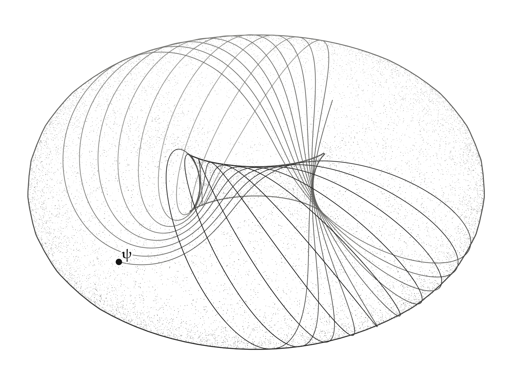
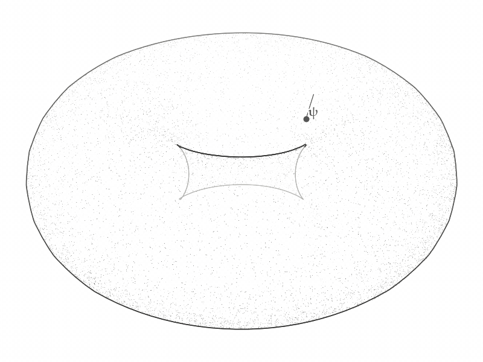

# Qutrit Orbit

The [conjugate-planes](2_conjugate-planes.md) qubit lives in $\mathbb{R}^4$, small enough that its two conjugate planes can be laid out side by side. A qutrit has three modes, so its state space is $\mathbb{C}^3 = \mathbb{R}^6$, and this example draws no planes at all. It draws the state's evolution $\mathbf{ψ}(t) = e^{-iHt} \mathbf{ψ}(0)$ through its phase space, the same kind of evolution as the qubit's, with three modes instead of two: the populations are conserved, the unobservable global phase is removed, and what is left is a 2-torus of relative phases, over which the state winds along a line that never closes. The torus sits on a 3-sphere, and a stereographic projection draws it in three dimensions as a torus of revolution. The code is the `qutrit_orbit` example:

```
uv run python -m morphis.examples.qutrit_orbit
uv run python -m morphis.examples.qutrit_orbit --animate
```

The first writes `figures/qutrit-orbit/qutrit-orbit.png` and the second `figures/qutrit-orbit/qutrit-orbit.gif`. Both print the numerical checks quoted below.

## The Qutrit

The system is a spin-1 in a magnetic field tilted from $z$ by an angle $β$, with a quadratic shift $D$ along $z$:

```math
H = \cos β \, S_z + \sin β \, S_x + D \, S_z^2
```

in units of the field strength, on the lab states $m = +1, 0, -1$. The example takes $β = 0.9$ and $D = 0.4$. The Hamiltonian has three energies:

```math
(E_1, E_2, E_3) = (-0.7517, \, +0.2510, \, +1.3007)
```

The state starts in the lab state $m = 0$.

```python
from numpy import abs as np_abs, array, cos, diag, sin, sqrt
from numpy.linalg import eigh

def hamiltonian() -> NDArray:
    spin_z = diag([1.0, 0.0, -1.0])
    spin_x = array([[0.0, 1.0, 0.0], [1.0, 0.0, 1.0], [0.0, 1.0, 0.0]]) / sqrt(2)

    return cos(TILT) * spin_z + sin(TILT) * spin_x + QUADRATIC_SHIFT * spin_z @ spin_z

ENERGIES, EIGENSTATES = eigh(hamiltonian())
MODULI = np_abs(EIGENSTATES.conj().T @ INITIAL_STATE)   # a_k, conserved
GAPS = ENERGIES[1:] - ENERGIES[0]                       # ω_21, ω_31
```

## The Phase Space

The state space $\mathbb{C}^3$ is the space with three modes, $\mathbb{R}^6$ with directions $1, \dot 1, 2, \dot 2, 3, \dot 3$, and the modes are taken to be the energy eigenstates $|k⟩$. In that basis the evolution is diagonal. Each amplitude keeps its modulus $a_k$ and turns its phase at its own rate:

```math
z^k(t) = a_k \, e^{-i E_k t}
```

with $Σ_k a_k^2 = 1$. In $\mathbb{R}^6$ this is a rotation by $-E_k t$ in each of the three conjugate planes, the three-mode version of the rotor evolution of the qubit. For the initial state $m = 0$ the populations $a_k^2$ are:

```math
(a_1^2, a_2^2, a_3^2) = (0.4568, \, 0.3460, \, 0.1972)
```

Fixing the three moduli leaves the three phases free, so the state stays on a 3-torus $T^3$ of fixed populations inside the unit sphere $S^5$.

The overall phase $e^{iα}$ of a state cannot be observed, and it moves all three phases together. Measuring the phases from the ground state's removes it: the ground amplitude becomes the constant $a_1$, real and positive, and the two remaining phases are coordinates $(u, v)$ on a 2-torus of relative phases:

```math
\mathbf{X}(u, v) = a_1 \, \mathbf{e}_1 + a_2 \left( \cos u \, \mathbf{e}_2 + \sin u \, \mathbf{e}_{\dot 2} \right) + a_3 \left( \cos v \, \mathbf{e}_3 + \sin v \, \mathbf{e}_{\dot 3} \right)
```

On it the state moves along a straight line of the torus coordinates, at the gap frequencies $ω_{k1} = E_k - E_1$:

```math
(u, v) = -(ω_{21} t, \, ω_{31} t)
```

with $ω_{21} = 1.0027$ and $ω_{31} = 2.0525$. A line on a torus closes only when its slope is rational. The slope here is:

```math
\frac{ω_{31}}{ω_{21}} = 2.046835
```

an irrational number for generic $β$ and $D$, so the orbit never closes and fills the torus densely. The ratio is close to 2, so locally the orbit follows the $(1, 2)$ curve, the one that winds twice around $v$ for each turn around $u$. Each turn of $u$ leaves $v$ ahead of that curve by $0.0468$ of a turn, about $17°$, so the near-$(1, 2)$ loop precesses slowly around the torus. Over the 60 time units drawn, $u$ makes 9.6 turns and $v$ makes 19.6.

The torus is a `Patch` on the product of two circles, and the line is its pullback:

```python
from numpy import exp
from morphis.elements import metric
from morphis.manifold import Circle, Patch

SPACE = metric(modes=3)

def relative_state(u, v):
    return [MODULI[0] + 0 * u, MODULI[1] * exp(1j * u), MODULI[2] * exp(1j * v)]

TORUS = Patch(relative_state, Circle() * Circle(), SPACE)

def phases(t: NDArray) -> NDArray:
    return -GAPS * array(t, dtype=float)[..., None]   # (u, v) at times t

TORUS(phases(times))                                   # the orbit, a Vector of ℝ⁶
```

The script checks this picture against the lab-frame evolution $\mathbf{ψ}(t) = V e^{-iEt} V^\dagger \mathbf{ψ}(0)$ at 241 times over the 60 time units. It reads each lab state in the energy eigenbasis, removes the ground state's phase, and compares the result with $\mathbf{X}(u(t), v(t))$. The largest difference is $9.4 \times 10^{-15}$. In the lab basis the same motion is far from simple: the population of $m = 0$ runs from 0.002 to 1.000 over the run, in a quasi-periodic pattern set by the same two incommensurate frequencies.

## The Drawing

Two steps carry the torus from $\mathbb{R}^6$ into the drawing space, and neither one loses information about it.

The first drops the ground mode. On the torus the coordinates along $\mathbf{e}_1$ and $\mathbf{e}_{\dot 1}$ are the constants $a_1$ and 0, so the orthographic map onto the four directions $2, \dot 2, 3, \dot 3$ is one-to-one on the torus. Its image lies on the 3-sphere of radius:

```math
ρ = \sqrt{a_2^2 + a_3^2} = 0.7370
```

since $a_2^2 + a_3^2 = 1 - a_1^2$ is the population outside the ground state.

The second is stereographic projection of that 3-sphere from the pole $ρ \, \mathbf{e}_{\dot 3}$ onto the hyperplane through the origin perpendicular to it. The pole is the point $z^2 = 0$, $z^3 = i ρ$, which the torus never reaches because $a_2 > 0$, so the whole torus is drawn, one-to-one and conformally. The picture coordinates are the directions $2, \dot 2, 3$ in order. A turn of $u$ is a rotation in the $\mathbf{e}_{2 \dot 2}$-plane, which fixes the pole and is drawn as a rotation about the vertical axis, so the torus is drawn as a torus of revolution. Circles of constant $v$ are its horizontal circles, and circles of constant $u$ its meridians. In a meridian half-plane the image of the circle of constant $u$ is a circle whose center radius $R$ and tube radius $r$ satisfy $R / r = ρ / a_3 = 1.66$.

The two steps are one `Projection`, built by composition. `EXCITED.target` is the Euclidean $\mathbb{R}^4$ of the four kept directions, and its fourth direction is $\mathbf{e}_{\dot 3}$:

```python
from morphis.elements import Dot, basis_vector
from morphis.visuals.projective import Projection

RADIUS = float(sqrt(MODULI[1] ** 2 + MODULI[2] ** 2))
EXCITED = Projection.orthographic([basis_vector(label, SPACE) for label in (2, Dot(2), 3, Dot(3))])
PROJECTION = Projection.stereographic(RADIUS * basis_vector(4, EXCITED.target)) @ EXCITED
```

The only things the figure gives up are the ones the physics gives up: the global phase, removed before drawing, and the constant ground amplitude. Distances on the torus are distorted by the conformal factor of the stereographic map, larger near the pole, and angles between curves are kept.

The ink `Sketch` draws the torus as a translucent `shell`, in pen and stipple and with no grid. Its contour, the curve where the surface turns from facing the eye to facing away, is found on the mesh of the patch from normals interpolated between vertices, and inked with a pen wobble, lighter the farther it is. Its body is stippled, densest where the surface turns edge-on to the eye and heavier on the side away from the light, with lighter dots on the far sheets. The cusped curve around the hole is part of the true contour of a torus of revolution seen from above its equator; an opaque drawing would hide part of it.

Ink curves have no hidden-line removal, and on a translucent torus none is wanted: the orbit is drawn in full, and depth is shown by graphite level. Each stretch of the orbit is inked darker the nearer it is to the camera, over the range of depths of the drawn torus, so the stretches running behind the tube read as seen through it.

```python
mesh = TORUS.mesh(MESH_SHAPE)
torus = PROJECTION(mesh.vertices)
sketch.shell(torus, mesh.cells.cells)

orbit = PROJECTION(TORUS(phases(linspace(0.0, t, count))))
strokes(sketch, orbit, depths, "fine", max(1, count // 25), ORBIT_INK)
sketch.point(orbit[-1], radius=4.0)
sketch.label(r"$\mathbf{ψ}$", orbit[-1], offset=(9, 7), size=15)
```

The still shows the whole run, 60 time units, with the state at its end.



## The Animation

The animation draws 300 frames over the 60 time units. Each frame builds the sketch at its time $t$ from the true geometry: the same torus, the orbit traced from 0 to $t$, and the state at $t$. The state runs along the near-$(1, 2)$ loop, and successive loops land beside one another as the precession carries them around the torus.

```python
times = linspace(0.0, DURATION, int(ANIMATION_SECONDS * FRAME_RATE) + 1)[1:]
animate(lambda t: create_sketch(theme, t), times, output, frame_rate=FRAME_RATE, dpi=ANIMATION_DPI)
```



The same projection, from a 3-sphere to a torus of revolution, draws the qubit's [Clifford torus](4_clifford-torus.md), where the two populations are equal and the torus is minimal in $S^3$.
