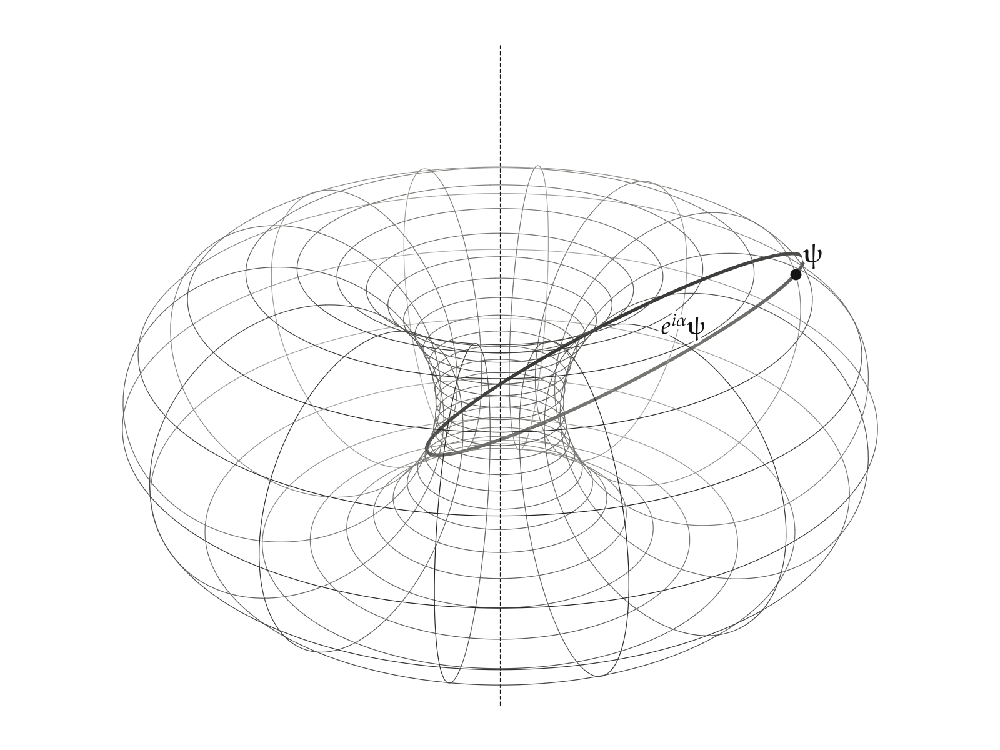

# Clifford Torus

A qubit state is a unit vector of $\mathbb{C}^2$, so the states form the 3-sphere $S^3$ in $\mathbb{R}^4$. Fixing the two populations leaves the two phases free, and the states of fixed populations sweep out a torus in $S^3$. At equal populations it is the Clifford torus: flat, minimal in $S^3$, and Lagrangian, and it is tiled by the orbits of the global phase, which are fibers of the Hopf map. This example checks each of those properties numerically from the patch alone and draws the torus by stereographic projection, where it becomes a torus of revolution. The code is the `clifford_torus` example:

```
uv run python -m morphis.examples.clifford_torus
```

It prints its checks and writes `figures/clifford-torus/clifford-torus.png`.

## The Torus

$\mathbb{C}^2$ is the space with two modes, $\mathbb{R}^4$ with directions $1, \dot 1, 2, \dot 2$. On the Bloch sphere a state has polar angle $χ$, with populations $|z^1|^2 = \cos^2(χ/2)$ and $|z^2|^2 = \sin^2(χ/2)$. The states of a fixed $χ$ are:

```math
\mathbf{X}(θ, φ) = \left( \cos(χ/2) e^{iθ}, \sin(χ/2) e^{iφ} \right)
```

with $θ$ and $φ$ each running over a circle. The Bloch vector of a state depends on $χ$ and on the relative phase $φ - θ$, so this torus is the preimage of the circle of latitude $χ$ on the Bloch sphere. At $χ = π/2$ both moduli are $1/\sqrt{2}$, the latitude circle is the equator, and the torus is the Clifford torus.

```python
from numpy import cos, exp, pi, sin
from morphis.elements import metric
from morphis.manifold import Circle, Patch

POLAR_ANGLE = pi / 2
SPACE = metric(modes=2)

def state(phase_1, phase_2):
    return [cos(POLAR_ANGLE / 2) * exp(1j * phase_1), sin(POLAR_ANGLE / 2) * exp(1j * phase_2)]

TORUS = Patch(state, Circle() * Circle(), SPACE)
```

## Its Geometry

The tangent vectors are $∂_θ \mathbf{X} = (i z^1, 0)$ and $∂_φ \mathbf{X} = (0, i z^2)$, orthogonal and of squared lengths $|z^1|^2$ and $|z^2|^2$. On the Clifford torus the induced metric is therefore constant:

```math
h_{ab} = \tfrac{1}{2} δ_{ab}
```

so the torus is flat, with Gaussian curvature $K = 0$, though it is bent in $\mathbb{R}^4$: each coordinate circle curves toward the axis of its own conjugate plane.

The mean curvature measures that bending. The second derivatives are $∂_θ^2 \mathbf{X} = -(z^1, 0)$ and $∂_φ^2 \mathbf{X} = -(0, z^2)$, and with equal moduli their trace against $h$ points straight back toward the origin:

```math
\mathbf{k} = -\mathbf{X}
```

Any surface in the unit sphere has a mean-curvature component $-\mathbf{X}$ normal to the sphere, from the sphere's own curvature. A surface whose mean curvature is exactly that has no mean curvature within $S^3$, so the Clifford torus is a minimal surface of $S^3$. For $χ \ne π/2$ the two circles have different radii, the trace is no longer parallel to $\mathbf{X}$, and the torus is not minimal.

The complex structure $J$ multiplies by $i$, so $J ∂_θ \mathbf{X} = -(z^1, 0)$ and $J ∂_φ \mathbf{X} = -(0, z^2)$. Both are orthogonal to the two tangent vectors, so $J$ carries each tangent plane into the normal plane, and the Kähler angle is:

```math
θ_K = π/2
```

The torus is Lagrangian, the opposite extreme from the complex curves of the [Calabi–Yau slice](6_calabi-yau-slice.md), whose tangent planes are closed under $J$ with Kähler angle 0. Every torus of fixed populations is flat and Lagrangian, and the Clifford torus is the one among them that is also minimal.

Every quantity is a method of the patch, computed in the ambient $\mathbb{R}^4$ from the map alone:

```python
from morphis.operations import kahler_angle

grid = TORUS.grid((24, 24))
TORUS.induced_metric(grid)                             # ½ δ_ab
TORUS.gaussian_curvature(grid)                         # 0
TORUS.mean_curvature(grid).data + TORUS(grid).data     # k + X = 0
kahler_angle(TORUS.tangent_frame(grid))                # π/2
```

On a $24 \times 24$ grid the script reports:

| Quantity | Closed form | Computed |
|---|---|---|
| induced metric | $h_{11} = 1/2$, $h_{12} = 0$ | $h_{11} = 0.500000$, $\max |h_{12}| = 4.5 \times 10^{-14}$ |
| Gaussian curvature | $K = 0$ | $\max |K| = 1.3 \times 10^{-9}$ |
| mean curvature | $\mathbf{k} = -\mathbf{X}$ | $\max |\mathbf{k} + \mathbf{X}| = 5.0 \times 10^{-10}$ |
| Kähler angle | $θ_K / π = 1/2$ | $θ_K / π = 0.500000$ |

## The Hopf Fibers

The global phase $e^{iα} \mathbf{ψ}$ moves $θ$ and $φ$ together, $(θ, φ) \mapsto (θ + α, φ + α)$. Its orbits are the $(1, 1)$ curves of the torus, and they are great circles of $S^3$. Two states on one such circle differ only by a phase, so they have the same Bloch vector: each orbit is a fiber of the Hopf map $S^3 \to S^2$, and the torus is the union of the fibers over its latitude circle.

## The Drawing

The torus lies in $S^3$, and stereographic projection draws all of $S^3$ but one point in three dimensions. The figure projects from the pole $\mathbf{e}_{\dot 2}$ onto the hyperplane of the directions $1, \dot 1, 2$, which become the drawing's $x$, $y$, $z$:

```math
\mathbf{y} = \frac{\mathbf{x}_\perp}{1 - \mathbf{e}_{\dot 2} \cdot \mathbf{x}}
```

The pole has $|z^2| = 1$, which no point of the Clifford torus reaches, so the whole torus is drawn, one-to-one and conformally. A turn of $θ$ is a rotation in the $\mathbf{e}_{1 \dot 1}$-plane, which fixes the pole and is drawn as a rotation about the vertical axis, so the image is a torus of revolution. In a meridian half-plane the circle of constant $θ$ is drawn as a circle of radius 1 whose center lies at distance $\sqrt{2}$ from the axis. The axis itself is the image of the great circle $z^1 = 0$, which passes through the pole and is therefore drawn as a straight line.

Stereographic projection sends circles on the sphere to circles, so each Hopf fiber, a great circle of $S^3$, is drawn as a circle. On the torus of revolution these are neither meridians nor parallels: they are the slanted Villarceau circles, each winding once around the axis and once through the hole.

The `Stereographic` view names the pole and the axes by label. The example resolves it once against the space and uses the resulting `Projection` as a function on arrays of points, so the sketch receives drawing coordinates directly:

```python
from morphis.elements import Dot
from morphis.visuals.projective import Stereographic

STEREOGRAPHIC = Stereographic(axes=(1, Dot(1), 2), pole=Dot(2)).resolve(SPACE)

def stereographic(points: NDArray) -> NDArray:
    return STEREOGRAPHIC(points)
```

The ink `Sketch` draws 28 circles of constant $φ$, the horizontal parallels, and 14 circles of constant $θ$, the meridians, in hairline. Ink curves have no hidden-line removal, so depth is shown by graphite level: each curve is inked in short pieces, darker the nearer each piece is to the camera. One phase orbit, starting at $(θ, φ) = (0, 0.45 π)$, is drawn bold and labeled from $\mathbf{ψ}$ to $e^{iα} \mathbf{ψ}$, and the axis of revolution is a dashed construction line.

```python
for fixed in linspace(0.0, 2 * pi, N_CIRCLES[0], endpoint=False):
    circle = stack([loop, 0 * loop + fixed], axis=-1)
    strokes(sketch, stereographic(TORUS(circle).data), depths, "hair", 40)

start_1, start_2 = ORBIT_START
orbit = stereographic(TORUS(stack([start_1 + loop, start_2 + loop], axis=-1)).data)
strokes(sketch, orbit, depths, "bold", 60, levels=(1.0, 0.5))

sketch.line((0.0, 0.0, -AXIS_REACH), (0.0, 0.0, AXIS_REACH), weight="hair")
```

The parallels crowd together on the inner side of the drawn torus. They are evenly spaced on the flat torus, and the conformal factor of the projection, which grows toward the pole, spreads the outer ones apart.



The [qutrit evolution](3_qutrit-evolution.md) draws a torus of relative phases with unequal populations by the same kind of projection, and there the orbit of the state is a line of irrational slope instead of a $(1, 1)$ circle.
