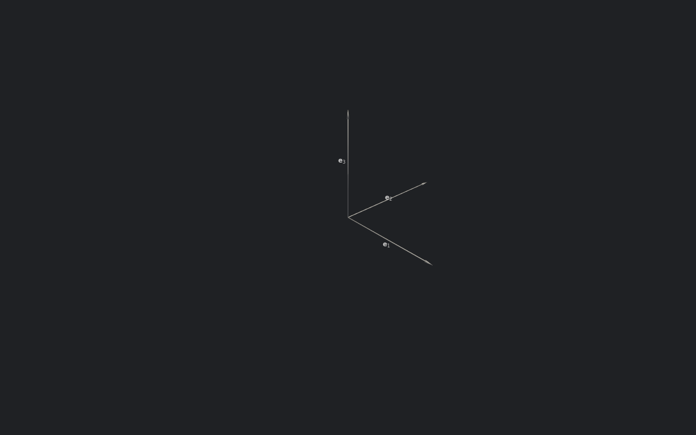
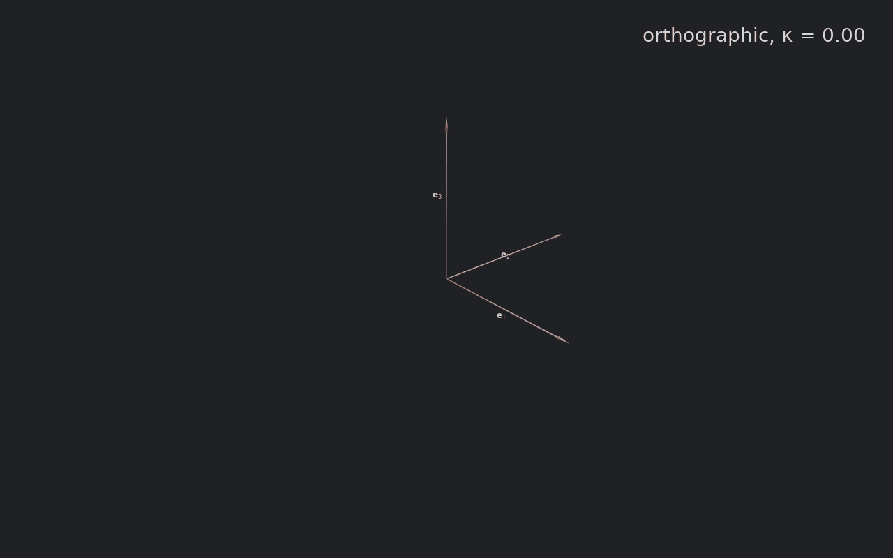
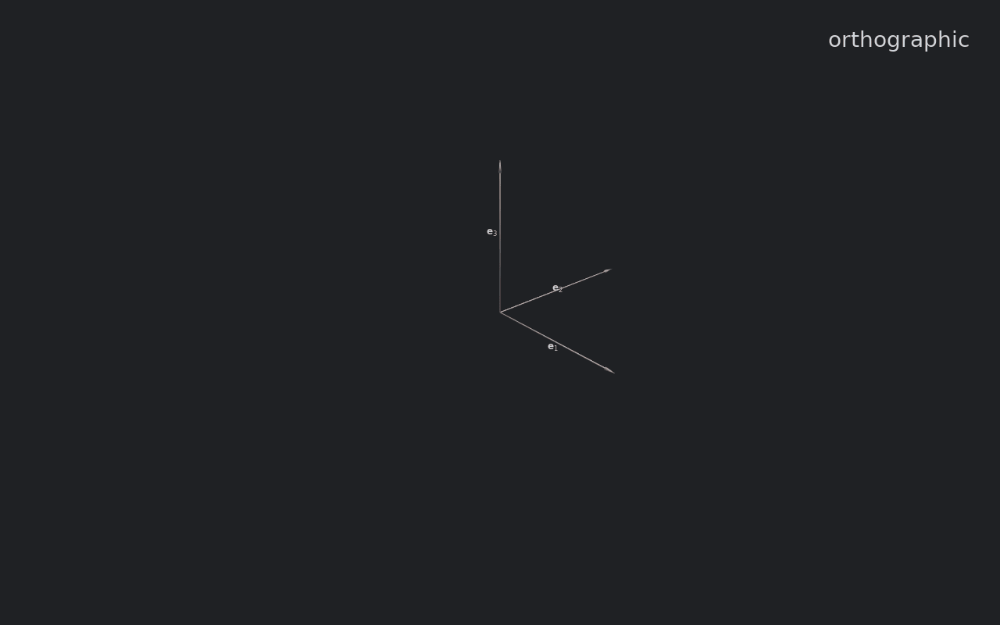

# Tesseract

A rotation of $\mathbb{R}^4$ can turn a single plane or two orthogonal planes at once. A single plane is generated by a blade $\hat b$, and its rotor is $\cos + \hat b \sin$. Two planes at once are generated by a bivector that is not simple, and its rotor has a grade-4 part, which morphis evaluates in closed form through the invariants of the bivector. This page draws both with the PyVista `Scene`: first the simple rotations of the `rotations_4d` example, which switches which three directions are drawn, then a double rotation of the unit tesseract, drawn through a perspective whose eye comes in from infinity, so the orthographic view turns continuously into the perspective one, and last the same tesseract turning steadily while the view glides through the projective family. The code is three examples:

```
uv run python -m morphis.examples.rotations_4d
uv run python -m morphis.examples.rotations_4d figures/tesseract/rotations-4d.gif
uv run python -m morphis.examples.tesseract
uv run python -m morphis.examples.tesseract figures/tesseract/tesseract.gif
uv run python -m morphis.examples.tesseract_projections
uv run python -m morphis.examples.tesseract_projections figures/tesseract/tesseract-projections.gif
```

Without an argument each opens a window and plays live. With an output path, `.gif` or `.mp4`, it renders off screen and records to that file.

## Simple Rotations and Switched Axes

The `rotations_4d` example turns the frame $(\mathbf e_1, \mathbf e_2, \mathbf e_3, \mathbf e_4)$ by two simple rotations in sequence, each a full turn:

$$
\begin{aligned}
\hat{b}_1 &= \frac{(\mathbf{e}_1 + \mathbf{e}_2) \wedge \mathbf{e}_3}{|(\mathbf{e}_1 + \mathbf{e}_2) \wedge \mathbf{e}_3|} \\
\hat{b}_2 &= \frac{(\mathbf{e}_1 + \mathbf{e}_2 + \mathbf{e}_3) \wedge \mathbf{e}_4}{|(\mathbf{e}_1 + \mathbf{e}_2 + \mathbf{e}_3) \wedge \mathbf{e}_4|}
\end{aligned}
$$

Each is a blade, a single plane, so its rotor is $\cos + \hat{b} \sin$ with no grade-4 part, and it leaves the plane's orthogonal complement fixed. The frame is advanced frame by frame with the rotor of each eased angle increment, and each full turn returns it to where it started.

```python
b1 = unit((e1 ^ e3) + (e2 ^ e3))
b2 = unit((e1 ^ e4) + (e2 ^ e4) + (e3 ^ e4))

scene = Scene(frame_rate=FRAME_RATE, theme="obsidian", window=output is None, projection=Orthographic(axes=(1, 2, 3)))
scene.add(F, color=RED, filled=True)

for b in [b1, b2]:
    for d_angle in d_angles:
        F.data[...] = F.transform(rotor(b, d_angle)).data
        scene.capture(t)
        t += dt

scene.set_projection(Orthographic(axes=(2, 3, 4)))     # then the same two rotations again
```

Under the view onto $\mathbf e_1, \mathbf e_2, \mathbf e_3$, the plane of $\hat b_1$ lies inside the drawn space, so the first turn is drawn as a rigid rotation of the visible cube, and $\mathbf e_4$ stays fixed and drawn at the origin. The plane of $\hat b_2$ contains $\mathbf e_4$, so the second turn swings part of the cube into the hidden direction. The drawn cube flattens as its edges leave the drawn space and fills out again as they return, while the drawing of $\mathbf e_4$ grows from a point and shrinks back.

`set_projection` then switches the view to $\mathbf e_2, \mathbf e_3, \mathbf e_4$, and every element in the Scene is redrawn through it, with the basis relabeled. The same two rotations now look different: the plane of $\hat b_1$ contains a component of the hidden $\mathbf e_1$, and the plane of $\hat b_2$ has its $\mathbf e_4$ in view. The rotations are the same rotations of $\mathbb{R}^4$; only the three directions chosen for the picture have changed.



The example runs at 60 frames per second. A GIF plays at most 50, so the recording keeps the frames that fall on its own ticks, and the clip keeps its nine-second duration.

## The Isoclinic Rotation

The tesseract example turns $\mathbb{R}^4$ in two planes at once, with the bivector:

$$
b = \mathbf{e}_{14} + \mathbf{e}_{23}
$$

The planes $\mathbf e_{14}$ and $\mathbf e_{23}$ share no direction, so their blades commute and $b$ generates a rotation in both at the same rate. A simple bivector has $b \wedge b = 0$, and this one does not:

$$
w = \tfrac{1}{2} b \wedge b = \mathbf{e}_{1234}
$$

Its square has a scalar and a grade-4 part, $b^2 = -2 + 2 \mathbf e_{1234}$. A rotation of two orthogonal planes at equal rates is *isoclinic*: every vector of $\mathbb{R}^4$ turns by the same angle, and no direction is left fixed.

The rotor of the turn is $R = \exp(-\tfrac{1}{2} b θ)$, which is what `rotor(B, angle)` computes. Splitting $b$ into its two planes, $b = b_1 + b_2$ with $b_1 = \mathbf e_{14}$ and $b_2 = \mathbf e_{23}$, the exponential is the product of two commuting rotors. Each plane turns by $θ$, and with $c = \cos(θ/2)$ and $s = \sin(θ/2)$:

$$
R = c^2 - c s \left( \mathbf{e}_{14} + \mathbf{e}_{23} \right) + s^2 \mathbf{e}_{1234}
$$

The grade-4 part $s^2 \mathbf e_{1234}$ is the product of the two bivector parts of the factors. At $θ = π/2$ the scalar and the grade-4 coefficient are both $\tfrac{1}{2}$, and at $θ = 2π$ both planes have made a full turn and $R = 1$.

## The Invariant Decomposition

`rotor` calls `exp_vector`, which hands a bivector to `exp_bivector`, and that function never forms the split. In four or five dimensions every bivector is a sum $b_1 + b_2$ of two commuting simple bivectors in orthogonal planes, with $b_k^2 = λ_k$ scalars, and the two invariants of $b$ determine the $λ_k$:

$$
\begin{aligned}
\langle b^2 \rangle_0 &= λ_1 + λ_2 \\
w^2 &= λ_1 λ_2
\end{aligned}
$$

so the $λ_k$ are the roots of $λ^2 - \langle b^2 \rangle_0 λ + w^2 = 0$. With $c_k = \cos \sqrt{-λ_k}$ and $s_k = \sin \sqrt{-λ_k} / \sqrt{-λ_k}$, the product $\exp(b_1) \exp(b_2)$ written through $b$ and $w$ alone is:

$$
\exp(b) = c_1 c_2 + s_1 s_2 w + \tfrac{1}{2} (c_2 s_1 + c_1 s_2) b + \tfrac{1}{2} D \left( \langle b^2 \rangle_0 b - 2 b w \right)
$$

where $D = (c_2 s_1 - c_1 s_2) / (λ_1 - λ_2)$ is a divided difference. This is the invariant decomposition of Roelfs and De Keninck. The functions $c_k$ and $s_k$ are entire in $λ_k$, equal to $\cosh$ and $\sinh$ for $λ_k > 0$ and to 1 at $λ_k = 0$, so one formula covers rotations, boosts, and null translations. A simple bivector has $w = 0$ and reduces to $\cos + b \sin$.

For the isoclinic generator the two roots coincide. Taking the generator $-\tfrac{1}{2} θ b$, its invariants are $\langle b^2 \rangle_0 = -θ^2/2$ and $w^2 = θ^4/16$, and the quadratic has the double root $λ = -θ^2/4$, one for each plane. When the roots meet any split serves, $\langle b^2 \rangle_0 b - 2 b w$ vanishes, and $D$ is taken at its finite limit, so the closed form holds there without a special case in the caller.

```python
from numpy import pi
from morphis.elements import basis_vectors, euclidean_metric
from morphis.transforms import rotor

g = euclidean_metric(4)
e1, e2, e3, e4 = basis_vectors(g)
B = (e1 ^ e4) + (e2 ^ e3)

R = rotor(B, pi / 2)                    # exp(-B π/4), grades 0, 2, and 4
R.data[0].data                          # 0.5
(R * e1 * ~R)[1].data                   # [0, 0, 0, 1]: e1 turned a quarter turn, onto e4
```

## The Tesseract

The tesseract is the unit cell of $\mathbb{R}^4$ centered on the origin, given to the Scene as the `Frame` of its four edge vectors and the corner they start from. With `filled=True` the Scene draws the frame's vectors as arrows and the cell they span, built from its $2^4 = 16$ corners. Each frame of the animation turns the edges and the corner by the sandwich, and the Scene draws what it is handed:

```python
edges = Frame(e1, e2, e3, e4)
corner = -0.5 * (e1 + e2 + e3 + e4)
start_edges, start_corner = edges.copy(), corner.copy()

scene = Scene(frame_rate=FRAME_RATE, window=output is None, projection=view(0.0))
scene.add(edges, color=RED, filled=True, origin=corner)

def turn(angle: float) -> None:
    R = rotor(B, angle)
    edges.data[...] = start_edges.transform(R).data
    corner.data[...] = (R * start_corner * ~R)[1].data
```

The animation fades the cell in, then eases the angle $θ$ from 0 to $π/2$ under the orthographic view, a quarter turn of every vector, which brings the cell to rest square to the axes. The view is a perspective with its eye at distance $1/κ$, and with the cell at rest $κ$ eases from 0 to $1/3$, so the change in the picture is the eye coming in alone. The cell then turns on from $π/2$ through a full turn in perspective. `scene.caption` names the view and gives $κ$ in the upper right corner of the window, orthographic while $κ$ is 0 and perspective once it is not, and the caption is drawn into the recorded frames.

```python
def view(κ: float) -> Projective:
    return Projective(eye=κ)

eye = 1.0 / EYE_DISTANCE
steps = (
    (0.0, pi / 2, 0.0, 0.0, DURATION_QUARTER_TURN),
    (pi / 2, pi / 2, 0.0, eye, DURATION_SLIDE),
    (pi / 2, 5 * pi / 2, eye, eye, DURATION_FULL_TURN),
)
for angle_start, angle_end, κ_start, κ_end, duration in steps:
    n_frames = int(duration * FRAME_RATE)
    for n in range(n_frames + 1):
        progress = ease_in_out_cubic(n / n_frames)
        κ = κ_start + (κ_end - κ_start) * progress
        scene.set_projection(view(κ))
        scene.caption(caption(κ))
        turn(angle_start + (angle_end - angle_start) * progress)
        scene.capture(t)
        t += dt
```

## Orthographic and Perspective

The orthographic view onto $\mathbf e_1, \mathbf e_2, \mathbf e_3$ drops $x^4$. At the start the cell's two cubes at $x^4 = \pm \tfrac{1}{2}$ are drawn on top of each other, and the tesseract looks like a single cube. As the rotation turns $\mathbf e_1$ toward $\mathbf e_4$ and $\mathbf e_2$ toward $\mathbf e_3$, the two cubes slide apart in the drawing, and the cell is drawn as the shadow of a tilted tesseract, a solid made of overlapping parallelepipeds. The map is linear, so parallel edges stay parallel, and the drawing is faithful on the three drawn directions and blind to the fourth.

The perspective view puts an eye on the $\mathbf e_4$ axis at distance $D = 3$ and draws a point at:

$$
\mathbf{x} \mapsto \frac{D (x^1, x^2, x^3)}{D - x^4}
$$

The dropped coordinate becomes scale. A corner of the cell lies at distance at most 1 from the origin, so $x^4$ stays between $-1$ and 1, the weight $D - x^4$ stays positive, and every corner is drawn at a finite point. At the start the cube at $x^4 = \tfrac{1}{2}$ is drawn larger by $3 / 2.5$ and the cube at $x^4 = -\tfrac{1}{2}$ smaller by $3 / 3.5$, so the far cube sits inside the near one. As the cell turns, cubes pass through each other, the inner one swelling outward while the outer one shrinks in.

The two views are one family. Written with $κ = 1/D$, the perspective image is:

$$
\mathbf{x} \mapsto \frac{(x^1, x^2, x^3)}{1 - κ x^4}
$$

The parameter $κ$ is the weight row of the projective map, the only entry that differs from the orthographic one. At $κ = 0$ the center of projection is the ideal point of $\mathbf e_4$ and the map is the orthographic view exactly, at the same scale. As $κ$ grows the center comes in from infinity along $\mathbf e_4$, and the image of each corner moves continuously, to first order by $κ x^4 (x^1, x^2, x^3)$. The near cube grows, the far cube shrinks inside it, and since the change is linear in $κ$ near zero, easing $κ$ itself gives an even slide.

The Scene maps every corner by the projective map itself and then draws the edges and faces between the mapped corners. A projective map sends lines to lines and planes to planes, so each drawn cell is the exact perspective image of a cell of the tesseract: its faces are general quadrilaterals, and its edges stay straight at every instant.



## A Tour of the Projective Family

Every view so far is a point of one family. The `Projective` view turns its screen by the rotor $R = \exp(-T/2)$ of a bivector $T$, and with $\mathbf{x}' = \tilde R \mathbf{x} R$ and $u = x'^4$ the dropped component, it draws a point at:

$$
\mathbf{x} \mapsto \frac{(x'^1, x'^2, x'^3) + u \mathbf{s}}{1 - κ u}
$$

The eye $κ$ is the inverse distance of the center of projection, the shear $\mathbf{s}$ draws the dropped direction as a picture vector, and the turn moves the screen through $\mathbb{R}^4$. Each parameter is a coordinate on the family, so moving them continuously moves the picture continuously. Turning the screen by $R$ draws the space as if it had been turned by $\tilde R$, so a camera moving through four dimensions is a rotor like any other.

The `tesseract_projections` example turns the tesseract steadily in the double rotation generated by $\mathbf e_{14} + \tfrac{1}{2} \mathbf e_{23}$, two orthogonal planes at rates 1 and 1/2, while the view tours the family:

| View | Parameters | Picture |
|------|------------|---------|
| orthographic | $κ = 0$ | the eye at infinity, the cubes at $x^4 = \pm \tfrac{1}{2}$ overlapping |
| perspective | $κ = 1/3$ | the eye at distance 3, the far cube inside the near one |
| close eye | $κ = 3/5$ | near cells swelling and far ones shrinking |
| turned screen | $κ = 1/3$, $T = \tfrac{π}{2} \mathbf e_{34}$ | $\mathbf e_4$ drawn and $\mathbf e_3$ dropped |
| oblique | $κ = 0$, $\mathbf{s} = (0.45, 0.3, 0.35)$ | a parallel projection, the cubes offset along $\mathbf{s}$ |
| orthographic | $κ = 0$ | back where it began |

Each view is held, then blended into the next with `toward` along an eased fraction. The turn ramps up from rest at the start and down to rest at the end, and runs at a steady rate through every hold and blend:

```python
view, name, fraction = schedule(time)       # start.toward(end, ease_in_out_cubic(fraction)) during a blend
scene.set_projection(view)
scene.caption(name)
clip.trail = TRAIL * sin(pi * fraction)     # an afterimage that swells and fades over each blend

angle += turn_rate(time, duration) * dt     # eased up from rest, steady, eased down to rest
turn(angle)
scene.capture(t)
```

While a blend runs, the recording keeps a fading afterimage, so the change of view leaves a trace. With trail $a$, each recorded frame is $(1 - a)$ times the new image plus $a$ times the frame before it. The trail swells to 0.6 at the middle of each blend and is 0 while a view is held.

Every corner of the tesseract lies within distance 1 of the origin, so with $κ \le 3/5$ the weight $1 - κ u$ stays at least $2/5$, and every corner is drawn at a finite point.


