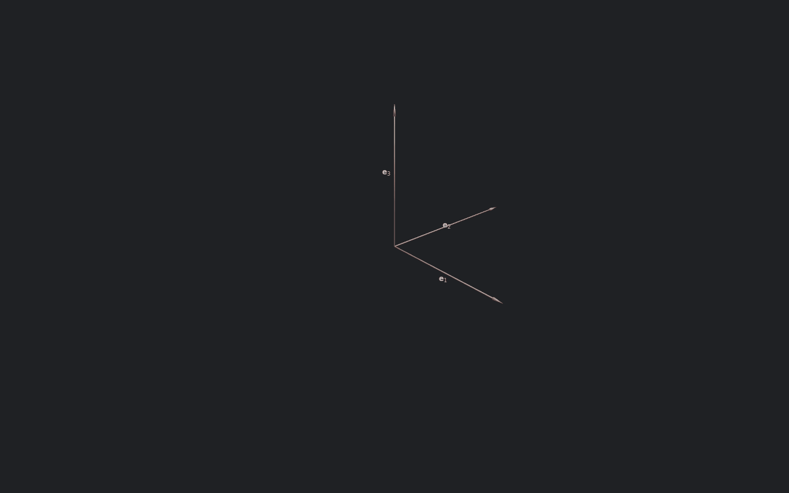
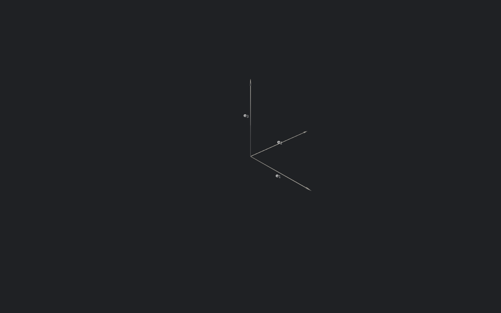

# Tesseract

A rotation of $\mathbb{R}^4$ can turn two orthogonal planes at once, and its generator is then a bivector that is not simple. Its rotor is not of the form $\cos + B \sin$: it has a grade-4 part, and morphis evaluates it in closed form through the invariants of $B$. This page draws such a rotation on the unit tesseract with the PyVista `Scene`, first orthographically and then in perspective, and compares it with the simple rotations of the `rotations_4d` example, which switches which three directions are drawn. The code is two examples:

```
uv run python -m morphis.examples.tesseract
uv run python -m morphis.examples.tesseract figures/tesseract/tesseract.gif
uv run python -m morphis.examples.rotations_4d
uv run python -m morphis.examples.rotations_4d figures/rotations-4d/rotations-4d.gif
```

Without an argument each opens a window and plays live. With an output path, `.gif` or `.mp4`, it renders off screen and records to that file.

## The Isoclinic Rotation

The tesseract example turns $\mathbb{R}^4$ with the bivector:

```math
B = \mathbf{e}_{14} + \mathbf{e}_{23}
```

The planes $\mathbf{e}_{14}$ and $\mathbf{e}_{23}$ share no direction, so their blades commute and $B$ generates a rotation in both at the same rate. A simple bivector has $B \wedge B = 0$, and this one does not:

```math
W = \tfrac{1}{2} \, B \wedge B = \mathbf{e}_{1234}
```

Its square has a scalar and a grade-4 part, $B^2 = -2 + 2 \, \mathbf{e}_{1234}$. A rotation of two orthogonal planes at equal rates is *isoclinic*: every vector of $\mathbb{R}^4$ turns by the same angle, and no direction is left fixed.

The rotor of the turn is $R = \exp(-\tfrac{1}{2} B \, θ)$, which is what `rotor(B, angle)` computes. Splitting $B$ into its two planes, $B = B_1 + B_2$ with $B_1 = \mathbf{e}_{14}$ and $B_2 = \mathbf{e}_{23}$, the exponential is the product of two commuting rotors. Each plane turns by $θ$, and with $c = \cos(θ/2)$ and $s = \sin(θ/2)$:

```math
R = c^2 - c s \left( \mathbf{e}_{14} + \mathbf{e}_{23} \right) + s^2 \, \mathbf{e}_{1234}
```

The grade-4 part $s^2 \, \mathbf{e}_{1234}$ is the product of the two bivector parts of the factors. At $θ = π/2$ the scalar and the grade-4 coefficient are both $\tfrac{1}{2}$, and at $θ = 2π$ both planes have made a full turn and $R = 1$.

## The Invariant Decomposition

`rotor` calls `exp_vector`, which hands a bivector to `exp_bivector`, and that function never forms the split. In four or five dimensions every bivector is a sum $B_1 + B_2$ of two commuting simple bivectors in orthogonal planes, with $B_k^2 = λ_k$ scalars, and the two invariants of $B$ determine the $λ_k$:

```math
\begin{aligned}
\braket{B^2}_0 &= λ_1 + λ_2 \\ \\
W^2 &= λ_1 λ_2
\end{aligned}
```

so the $λ_k$ are the roots of $λ^2 - \braket{B^2}_0 \, λ + W^2 = 0$. With $c_k = \cos \sqrt{-λ_k}$ and $s_k = \sin \sqrt{-λ_k} / \sqrt{-λ_k}$, the product $\exp(B_1) \exp(B_2)$ written through $B$ and $W$ alone is:

```math
\exp(B) = c_1 c_2 + s_1 s_2 \, W + \tfrac{1}{2} (c_2 s_1 + c_1 s_2) \, B + \tfrac{1}{2} D \left( \braket{B^2}_0 \, B - 2 B W \right)
```

where $D = (c_2 s_1 - c_1 s_2) / (λ_1 - λ_2)$ is a divided difference. This is the invariant decomposition of Roelfs and De Keninck. The functions $c_k$ and $s_k$ are entire in $λ_k$, equal to $\cosh$ and $\sinh$ for $λ_k > 0$ and to 1 at $λ_k = 0$, so one formula covers rotations, boosts, and null translations. A simple bivector has $W = 0$ and reduces to $\cos + B \sin$.

For the isoclinic generator the two roots coincide. Taking the generator $-\tfrac{1}{2} θ B$, its invariants are $\braket{B^2}_0 = -θ^2/2$ and $W^2 = θ^4/16$, and the quadratic has the double root $λ = -θ^2/4$, one for each plane. When the roots meet any split serves, $\braket{B^2}_0 \, B - 2 B W$ vanishes, and $D$ is taken at its finite limit, so the closed form holds there without a special case in the caller.

```python
from numpy import pi
from morphis.elements import basis_vectors, euclidean_metric
from morphis.transforms import rotor

g = euclidean_metric(4)
e1, e2, e3, e4 = basis_vectors(g)
B = (e1 ^ e4) + (e2 ^ e3)

R = rotor(B, pi / 2)                    # exp(-B π/4), grades 0, 2, and 4
R.data[0].data                          # 0.5
(R * e1 * ~R)[1].data                   # [0, 0, 0, 1]: e1 turned a quarter turn, onto e4
```

## The Tesseract

The tesseract is the unit cell of $\mathbb{R}^4$ centered on the origin, given to the Scene as the `Frame` of its four edge vectors and the corner they start from. With `filled=True` the Scene draws the frame's vectors as arrows and the cell they span, built from its $2^4 = 16$ corners. Each frame of the animation turns the edges and the corner by the sandwich, and the Scene draws what it is handed:

```python
edges = Frame(e1, e2, e3, e4)
corner = -0.5 * (e1 + e2 + e3 + e4)
start_edges, start_corner = edges.copy(), corner.copy()

scene = Scene(frame_rate=FRAME_RATE, window=output is None, projection=Orthographic(axes=(1, 2, 3)))
scene.add(edges, color=RED, filled=True, origin=corner)

def turn(angle: float) -> None:
    R = rotor(B, angle)
    edges.data[...] = start_edges.transform(R).data
    corner.data[...] = (R * start_corner * ~R)[1].data
```

The animation fades the cell in, then eases the angle $θ$ from 0 to $π/2$ under the orthographic view, a quarter turn of every vector, switches to the perspective view, and eases $θ$ on from $π/2$ through a further full turn, so the picture continues across the switch.

```python
phases = ((Orthographic(axes=(1, 2, 3)), 0.0, pi / 2), (Perspective(distance=EYE_DISTANCE), pi / 2, 2 * pi))
for view, start, total in phases:
    scene.set_projection(view)
    for n in range(n_turn + 1):
        turn(start + total * ease_in_out_cubic(n / n_turn))
        scene.capture(t)
        t += dt
```

## Orthographic and Perspective

The orthographic view onto $\mathbf{e}_1, \mathbf{e}_2, \mathbf{e}_3$ drops $x^4$. At the start the cell's two cubes at $x^4 = \pm \tfrac{1}{2}$ are drawn on top of each other, and the tesseract looks like a single cube. As the rotation turns $\mathbf{e}_1$ toward $\mathbf{e}_4$ and $\mathbf{e}_2$ toward $\mathbf{e}_3$, the two cubes slide apart in the drawing, and the cell is drawn as the shadow of a tilted tesseract, a solid made of overlapping parallelepipeds. The map is linear, so parallel edges stay parallel, and the drawing is faithful on the three drawn directions and blind to the fourth.

The perspective view puts an eye on the $\mathbf{e}_4$ axis at distance $D = 3$ and draws a point at:

```math
\mathbf{x} \mapsto \frac{D \, (x^1, x^2, x^3)}{D - x^4}
```

The dropped coordinate becomes scale. A corner of the cell lies at distance at most 1 from the origin, so $x^4$ stays between $-1$ and 1, the weight $D - x^4$ stays positive, and every corner is drawn at a finite point. At the start the cube at $x^4 = \tfrac{1}{2}$ is drawn larger by $3 / 2.5$ and the cube at $x^4 = -\tfrac{1}{2}$ smaller by $3 / 3.5$, so the far cube sits inside the near one. As the cell turns, cubes pass through each other, the inner one swelling outward while the outer one shrinks in.

The Scene maps every corner by the projective map itself and then draws the edges and faces between the mapped corners. A projective map sends lines to lines and planes to planes, so each drawn cell is the exact perspective image of a cell of the tesseract: its faces are general quadrilaterals, and its edges stay straight at every instant.



## Simple Rotations and Switched Axes

The `rotations_4d` example turns the frame $(\mathbf{e}_1, \mathbf{e}_2, \mathbf{e}_3, \mathbf{e}_4)$ by two simple rotations in sequence, each a full turn:

```math
\begin{aligned}
\hat{b}_1 &= \frac{(\mathbf{e}_1 + \mathbf{e}_2) \wedge \mathbf{e}_3}{|(\mathbf{e}_1 + \mathbf{e}_2) \wedge \mathbf{e}_3|} \\ \\
\hat{b}_2 &= \frac{(\mathbf{e}_1 + \mathbf{e}_2 + \mathbf{e}_3) \wedge \mathbf{e}_4}{|(\mathbf{e}_1 + \mathbf{e}_2 + \mathbf{e}_3) \wedge \mathbf{e}_4|}
\end{aligned}
```

Each is a blade, a single plane, so its rotor is $\cos + \hat{b} \sin$ with no grade-4 part, and it leaves the plane's orthogonal complement fixed. The frame is advanced frame by frame with the rotor of each eased angle increment, and each full turn returns it to where it started.

```python
b1 = unit((e1 ^ e3) + (e2 ^ e3))
b2 = unit((e1 ^ e4) + (e2 ^ e4) + (e3 ^ e4))

scene = Scene(frame_rate=FRAME_RATE, theme="obsidian", window=output is None, projection=Orthographic(axes=(1, 2, 3)))
scene.add(F, color=RED, filled=True)

for b in [b1, b2]:
    for d_angle in d_angles:
        F.data[...] = F.transform(rotor(b, d_angle)).data
        scene.capture(t)
        t += dt

scene.set_projection(Orthographic(axes=(2, 3, 4)))     # then the same two rotations again
```

Under the view onto $\mathbf{e}_1, \mathbf{e}_2, \mathbf{e}_3$, the plane of $\hat{b}_1$ lies inside the drawn space, so the first turn is drawn as a rigid rotation of the visible cube, and $\mathbf{e}_4$ stays fixed and drawn at the origin. The plane of $\hat{b}_2$ contains $\mathbf{e}_4$, so the second turn swings part of the cube into the hidden direction. The drawn cube flattens as its edges leave the drawn space and fills out again as they return, while the drawing of $\mathbf{e}_4$ grows from a point and shrinks back.

`set_projection` then switches the view to $\mathbf{e}_2, \mathbf{e}_3, \mathbf{e}_4$, and every element in the Scene is redrawn through it, with the basis relabeled. The same two rotations now look different: the plane of $\hat{b}_1$ contains a component of the hidden $\mathbf{e}_1$, and the plane of $\hat{b}_2$ has its $\mathbf{e}_4$ in view. The rotations are the same rotations of $\mathbb{R}^4$; only the three directions chosen for the picture have changed.



The example runs at 60 frames per second. A GIF plays at most 50, so the recording keeps the frames that fall on its own ticks, and the clip keeps its nine-second duration.
