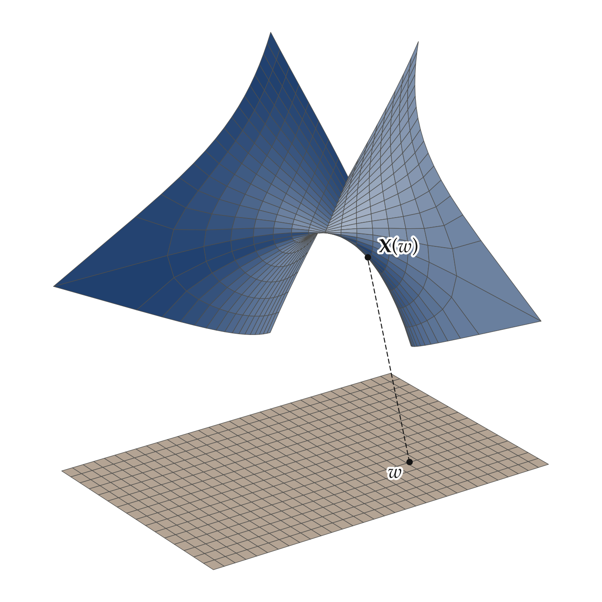
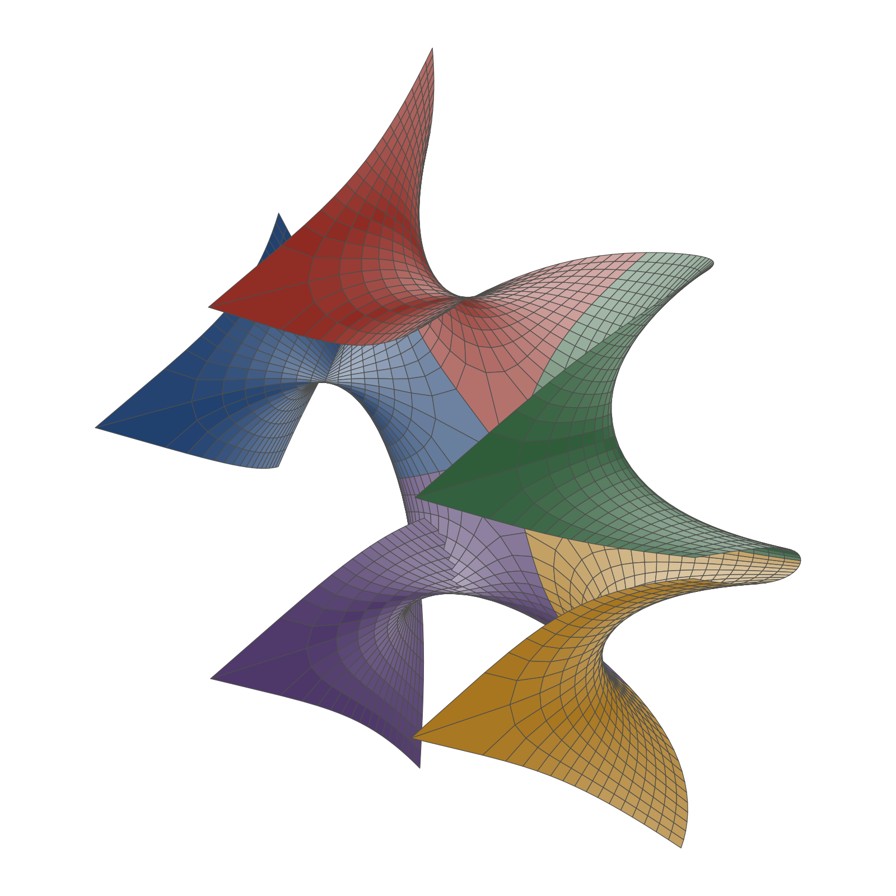
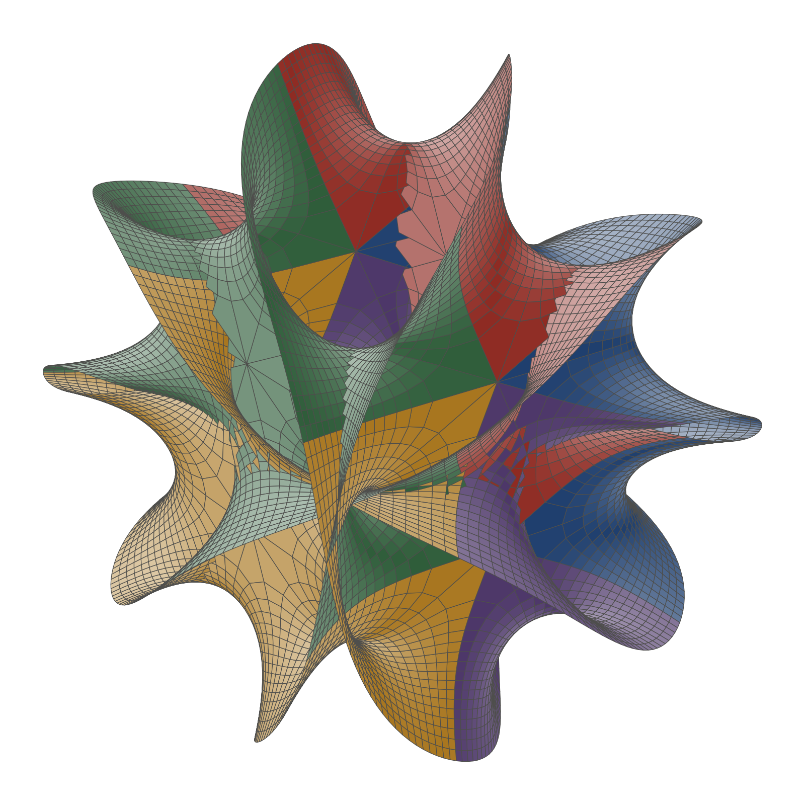
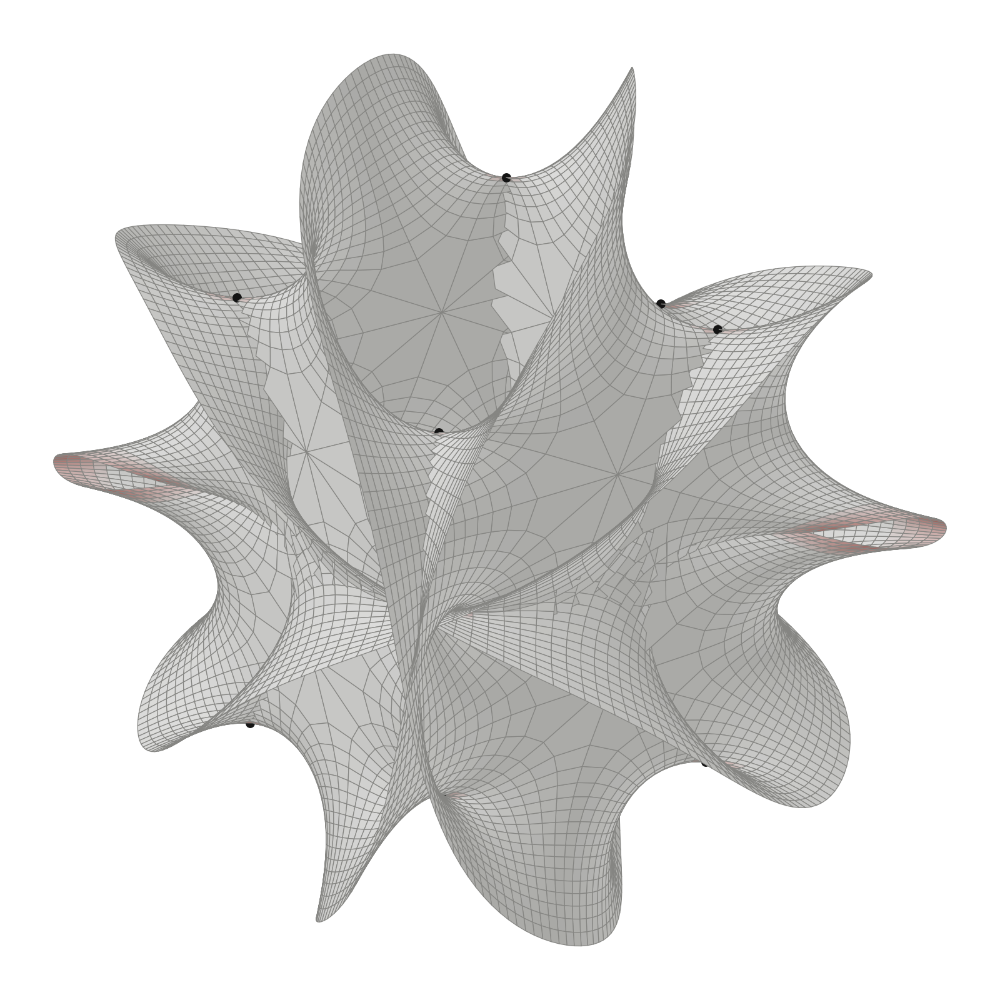

# A Calabi–Yau Slice

The quintic threefold, the zero set of $z_1^5 + z_2^5 + z_3^5 + z_4^5 + z_5^5$ in $\mathbb{CP}^4$, is the standard example of a Calabi–Yau manifold. It has six real dimensions, so its standard picture shows a slice of it: the complex curve

```math
z_1^5 + z_2^5 = 1
```

in $\mathbb{C}^2$. A point of $\mathbb{C}^2$ is a point of $\mathbb{R}^4$, and one complex equation removes two real dimensions, so the curve is a real surface in four dimensions. This document builds it in four stages: one patch, the copies of that patch made by the curve's symmetry, the welded surface, and its projection into three dimensions. Each stage states the mathematics and then the morphis code that carries it out. The code is the `calabi_yau` example:

```
uv run python -m morphis.examples.calabi_yau
```

It checks every claim below numerically and writes the four figures to `figures/calabi-yau/`.

## The Space

$\mathbb{C}^2$ is the space with two modes. Each mode $m$ owns a direction $\mathbf e_m$ and its partner $\mathbf e_{\dot m}$, and a real vector reads as the complex amplitudes

```math
z^m = v^m + i v^{\dot m}
```

Multiplication by $i$ is the complex structure $J$, the quarter turn $J \mathbf e_m = \mathbf e_{\dot m}$, so the complex arithmetic of $\mathbb{C}^2$ is ordinary geometry in $\mathbb{R}^4$.

```python
from morphis.elements import Dot, Vector, basis_vector, metric

SPACE = metric(modes=2)                       # ℝ⁴ with labels 1, 1̇, 2, 2̇
E1, F1, E2, F2 = (basis_vector(label, SPACE) for label in (1, Dot(1), 2, Dot(2)))

v = Vector.from_amplitudes([1.0, 1j], SPACE)  # the point (1, i) of ℂ²
v.amplitudes                                  # [1, 1j]
```

## Stage 1: One Patch

**The mathematics.** The identity $\cosh^2 w - \sinh^2 w = 1$ solves the equation at once. Take fifth roots of each term:

```math
\begin{aligned}
z_1(w) &= \cosh(w)^{2/5} \\
z_2(w) &= (-i \sinh w)^{2/5}
\end{aligned}
```

Then $z_1^5 = \cosh^2 w$ and $z_2^5 = -\sinh^2 w$, which sum to 1. The complex coordinate runs over the rectangle $w = ξ + i θ$ with $ξ \in [-a, a]$ and $θ \in [0, π/2]$. On it, both $\cosh w$ and $-i \sinh w$ have non-negative real part, so the principal fifth root is smooth inside, and the map $w \mapsto (z_1, z_2)$ is one sheet of the curve.

The map is holomorphic in $w$, which fixes the local geometry. Moving $w$ by $i$ moves the point by $J$ applied to the motion along $ξ$:

```math
∂_θ \mathbf{X} = J (∂_ξ \mathbf{X})
```

Each tangent plane is therefore a complex line, closed under $J$, with Kähler angle 0. A complex curve is a minimal surface: its mean curvature vanishes, $\mathbf{k} = 0$. In coordinates where $h_{ab}$ is a multiple of $δ_{ab}$, minimality means $\mathbf k_{22} = -\mathbf k_{11}$, and the Gauss equation gives a curvature that is never positive:

```math
K = -\frac{\mathbf{k}_{11} \cdot \mathbf{k}_{11} + \mathbf{k}_{12} \cdot \mathbf{k}_{12}}{\det h}
```

The sheet is saddle-shaped at every point. Two points on its edge are special: $w = 0$, where $z_2 = 0$, and $w = i π/2$, where $z_1 = 0$. There the fifth root is not differentiable, and the next stage shows why.



**The code.** A `Patch` is the map, the domain, and the space. A complex coordinate is written with the imaginary unit, and the map receives $w$ itself and returns the two amplitudes:

```python
from numpy import cosh, exp, pi, sinh
from morphis.manifold import Interval, Patch

def sheet(k1, k2):
    def X(w):
        z1 = exp(2j * pi * k1 / 5) * cosh(w) ** (2 / 5)
        z2 = exp(2j * pi * k2 / 5) * (-1j * sinh(w)) ** (2 / 5)
        return [z1, z2]

    return Patch(X, Interval(-1.2, 1.2) + 1j * Interval(0, pi / 2), SPACE)

patch = sheet(0, 0)
coordinates = patch.grid((33, 17))            # real coordinates (ξ, θ), shape (33, 17, 2)
patch(coordinates)                            # the points, a Vector with lot (33, 17)
```

Every geometric quantity is a method taking the same coordinates. Because the coordinate is complex, the derivative along $θ$ is computed as $i$ times the derivative along $ξ$, so the tangent frame is an exact $J$ pair:

```python
from morphis.operations import kahler_angle

kahler_angle(patch.tangent_frame(coordinates))  # 0: complex lines
patch.mean_curvature(coordinates)               # 0: minimal
patch.gaussian_curvature(coordinates)           # negative everywhere
```

## Stage 2: The Phases

**The mathematics.** Let $ζ = e^{2πi/5}$. Since $ζ^5 = 1$, multiplying either coordinate by a power of $ζ$ keeps a solution a solution:

```math
(z_1, z_2) \mapsto (ζ^{k_1} z_1, ζ^{k_2} z_2)
```

The first sheet took one fifth root of each coordinate, the principal one, while a nonzero complex number has five, differing by powers of $ζ$. Each coordinate offers five independent choices of root, so the 25 pairs $(k_1, k_2)$, with $k_1, k_2 \in \lbrace 0, \ldots, 4 \rbrace$, copy the first sheet into 25 sheets, and together they cover the curve. A curve of degree $n$ needs $n^2$ sheets in the same way. Fixing $k_1 = 0$ leaves five sheets that differ only by the phase of $z_2$. Near $w = 0$ the second coordinate behaves like $z_2 \approx (-i w)^{2/5}$, which squeezes the half-disk $θ \ge 0$ around $w = 0$, of angle $π$, into a wedge of angle $2π/5$ around $z_2 = 0$. Five wedges, turned by $ζ$, close up into a full turn. So the five sheets fan out around the point $(1, 0)$, and the point is smooth on the curve, though no single sheet covers a neighborhood of it. The special points of stage 1 belong to the parametrization, not to the curve.



**The code.** A `Mesh` is sampled vertices with their `CellComplex`. Meshes combine by disjoint union, and welding glues vertices that coincide in $\mathbb{R}^4$. Each cell remembers the piece it came from, which is what colors the figure:

```python
from morphis.manifold import Mesh

fan = Mesh.union(*(sheet(0, k2).mesh((33, 17)) for k2 in range(5))).welded(1e-6)
fan.pieces                                    # per cell: which sheet, 0 to 4
```

## Stage 3: The Atlas

**The mathematics.** Welded together, the 25 sheets form one surface, and its topology is that of the curve. Closed up in $\mathbb{CP}^2$, a smooth curve of degree $n$ has genus $(n - 1)(n - 2) / 2$, so the quintic curve is a sphere with 6 handles. The affine curve misses the points at infinity, where $z_1^5 + z_2^5 = 0$, one for each fifth root of $-1$. Cutting the sheets off at $|ξ| = a$ replaces each missing point with a boundary circle, so the Euler characteristic is:

```math
χ = 2 - 2 g - n = 2 - 12 - 5 = -15
```

with 5 boundary circles. The five flaring tips in the figure are those ends, each reaching toward a point at infinity.



**The code.** An `Atlas` is the set of patches. Its mesh samples every patch, takes the union, and welds it, and the topology is read from the welded complex:

```python
from morphis.manifold import Atlas

atlas = Atlas([sheet(k1, k2) for k1 in range(5) for k2 in range(5)])
mesh = atlas.mesh((33, 17), tolerance=1e-6)

mesh.cells.euler_characteristic()             # -15
mesh.cells.boundary().components()            # 5
z = mesh.vertices.amplitudes                  # every vertex satisfies z_1⁵ + z_2⁵ = 1
```

The complex knows nothing of positions or metric. The same `CellComplex` methods give $χ = 0$ for a torus and $χ = 2$ for a sphere.

## Stage 4: The Projection

**The mathematics.** Drawing in three dimensions discards one direction of $\mathbb{R}^4$. The figures use the orthographic projection onto $\mathbf e_1$, $\mathbf e_2$, and a blend of the two imaginary directions:

```math
\mathbf{s} = \cos α \mathbf{e}_{\dot 1} + \sin α \mathbf{e}_{\dot 2}
```

so the picture shows $\mathrm{Re} z_1$, $\mathrm{Re} z_2$, and $\mathbf{s} \cdot \mathbf{x}$, and hides the direction:

```math
\mathbf{n} = -\sin α \mathbf{e}_{\dot 1} + \cos α \mathbf{e}_{\dot 2}
```

Two sheets that are disjoint in $\mathbb{R}^4$ can cross in the picture, and the surface can pinch. A pinch point is a point whose tangent plane contains $\mathbf{n}$: the projection crushes that plane to a line, and the drawn surface folds into a cusp there. Differentiating the curve's equation gives $z_1^4 dz_1 + z_2^4 dz_2 = 0$, so the tangent line at a point is spanned over $\mathbb{C}$ by $(z_2^4, -z_1^4)$. As amplitudes, $\mathbf{n}$ is $(-i \sin α, i \cos α)$. It lies in the tangent line exactly when the two are complex multiples, which is when:

```math
\left( \frac{z_2}{z_1} \right)^4 = \tan α
```

Write $z_2 = t z_1$, so $t^4 = \tan α$ gives four values of $t$, and the curve's equation becomes $z_1^5 (1 + t^5) = 1$, with five roots $z_1$ for each. At $α = π/4$ the four values are $t = 1, i, -1, -i$, and $t^5 = t$. The value $t = -1$ makes $1 + t^5 = 0$, which sends the point to infinity. That leaves $3 \times 5 = 15$ pinch points. They are features of the drawing, not of the curve, and they move as $α$ changes.

How close the drawing comes to pinching is measured by the differential of the projection on each tangent plane, as the ratio of its singular values $s_{\min} / s_{\max}$. It is 1 where the plane keeps its shape in the picture and 0 at a pinch point.



**The code.** A `Projection` is a projective map on homogeneous coordinates, the same kind of map behind every view described in [Visualization Styles](1_visualization-styles.md). It is built from the screen directions and applied to vectors of any lot:

```python
from numpy import cos, sin
from morphis.visuals.projective import Projection

angle = pi / 4
projection = Projection.orthographic([E1, E2, cos(angle) * F1 + sin(angle) * F2])

drawn = projection(mesh.vertices)             # shape (n_vertices, 3)

points, frame = patch(coordinates), patch.tangent_frame(coordinates)
projection.pushforward(points, frame)         # dΠ on each tangent plane, shape (33, 17, 2, 3)
projection.pinching(points, frame)            # s_min / s_max, 0 at a pinch point
```

The ink `Sketch` draws the mesh as a shaded surface, cells painted from far to near. The pinch points are passed as dots, so a dot on a sheet behind another sheet is hidden by it:

```python
from morphis.visuals.ink import Camera, Sketch

sketch = Sketch(camera=Camera(azimuth=-35, elevation=25, distance=14, fov=15), size=(8, 8))
sketch.surface(drawn, mesh.cells.cells, colors=colors, dots=projection(pinch_points))  # one color per cell; the 15 points as a Vector
sketch.save("figures/calabi-yau/calabi-yau-pinch.png")
```

## From the Slice to the Threefold

The slice shows the threefold's local character: it is a complex submanifold, so its tangent spaces are complex, it is minimal, and it is curved. Two things separate the threefold from the slice. The threefold lives in $\mathbb{CP}^4$, which is curved, so its patches are written in the affine charts of projective space, and its curvature no longer follows from the Gauss equation of a flat ambient space. Its Calabi–Yau metric, the Ricci-flat one whose existence is Yau's theorem, is not the metric induced from the ambient space, and it is known only numerically. The induced metric is the one morphis computes, and its Ricci curvature, from `ricci_curvature`, measures how far it is from being Ricci-flat.
